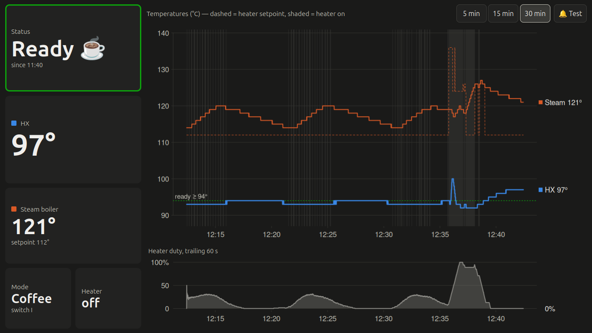

# MaraX Dashboard

A live touchscreen dashboard for the **Lelit MaraX V1** espresso machine, written in R/Shiny.
It reads the machine's serial data stream, charts the boiler and heat-exchanger
temperatures as they change, and plays a sound when the machine is ready to brew.

It's built to run full-screen on an old laptop sitting next to the machine
(developed for a Dell Inspiron 11 3157 at 1366×768). It also runs on macOS, Linux and
Windows for development, and has a built-in simulator so you can work on it without
the machine.



*Real data from a warmed-up MaraX in coffee mode. A shot has been pulled earlier: the
heater setpoint (dashed) jumps, the heater fires (shaded), and the steam boiler
recovers.*

*This is a work in progress.  The kiosk features are untested* 

## Features

- **Live tiles:** status, HX temperature (large), steam boiler temperature and
  setpoint, coffee/steam mode, and heater on/off.
- **Temperature chart:** HX and steam boiler on one °C axis, with the controller's
  heater setpoint as a dashed line, the ready threshold as a dotted line, and
  heater-on periods shaded.
- **Heater duty chart:** the share of the last 60 s the heater was on, which shows
  when the machine has settled.
- **5 / 15 / 30-minute views,** with touch-sized buttons.
- **Ready alert:** plays a sound once per warm-up when HX has reached your threshold
  and held steady. A 🔔 **Test** button plays it on demand.
- **No database:** keeps a rolling 30-minute window in memory, with no disk writes.
- **Simulator:** generates a sped-up warm-up so you can test the layout and the
  alert without the machine.
- **One R process, three platforms:** reads the serial port on macOS, Linux and
  Windows.

## Repository layout

| File | Purpose |
|---|---|
| `app.R` | The whole app: serial reader, rolling buffer, ready detection, charts, UI |
| `marax.yml` | Configuration: serial port, temperature switch setting, thresholds, sound |
| `README.md` | This file |
| `LICENSE` | MIT License |
| `images/screenshot.png` | Screenshot used in this README |

## Requirements

- R 4.x
- R packages: `shiny`, `yaml`, `later`, `beepr`
- **Windows only:** `serial`
- A USB-to-serial adapter connected to the MaraX's serial port (9600 baud, 8N1)

```r
install.packages(c("shiny", "yaml", "later", "beepr"))
install.packages("serial")   # Windows only
```

The same `app.R` runs on every platform. On Windows it loads `serial` to read the
port; on macOS and Linux it reads the port with base R and `stty`, so `serial`
isn't needed there.

## Quick start (simulator)

1. In `marax.yml`, set `simulate: true`.
2. Run the app from its folder:
   ```r
   shiny::runApp("~/marax", port = 3838)
   ```
3. Open <http://localhost:3838>.

The simulator runs a warm-up 10× faster than real time (`sim_speed`), so the
fast-heat countdown finishes in about 2 minutes. The ready alert fires about 6 minutes
after start, because HX must hold steady for `stable_minutes` of *real* time; the
speed-up doesn't shorten that. Simulated shots (brief HX dips) start after that.

## Connecting to the machine

### The data stream

The MaraX's Gicar control board sends one comma-separated ASCII line about every half
second. On the V1 board it has six fields:

```
C1.19,116,124,093,0840,1
```

| # | Example | Meaning |
|---|---|---|
| 1 | `C1.19` | Mode letter plus firmware version. `C` = coffee priority, `V` = steam priority |
| 2 | `116` | Steam boiler temperature (°C) |
| 3 | `124` | Steam boiler setpoint (°C). In coffee mode the controller moves this up and down to hold the HX temperature: it drops (e.g. to 112) to keep the heater off and jumps (e.g. to 136) to fire it during a shot |
| 4 | `093` | Heat exchanger (HX) temperature (°C) |
| 5 | `0840` | Fast-heat boost countdown (seconds); `0000` once boost has ended |
| 6 | `1` | Heater on/off |

Some later firmware adds a seventh pump on/off field; the app ignores it. Lines that
are garbled, have too few fields, or have out-of-range values are dropped.

The physical temperature switch (0 / I / II) is **not** in the data stream, so you set
it in `marax.yml`.

### Finding the serial port

With `port: auto`, the app uses the first USB serial adapter it finds. To set one
explicitly:

| OS | Port name | How to find it |
|---|---|---|
| Linux | `/dev/ttyUSB0` | `ls /dev/ttyUSB*` before and after plugging in |
| macOS | `/dev/cu.usbserial-XXXX` | `ls /dev/cu.*` before and after plugging in. Use `cu.`, not `tty.` |
| Windows | `COM3` | Device Manager → **Ports (COM & LPT)**, or `serial::listPorts()` |

The Status tile shows which port the app is watching while it waits for data.

To check that data is arriving before you start the app:

```bash
screen /dev/cu.usbserial-XXXX 9600    # macOS; on Linux use /dev/ttyUSB0
# quit with Ctrl-A, then K
```

**Linux:** your user needs to be in the `dialout` group to open the port.
Run `sudo usermod -aG dialout $USER`, then log out and back in.

**Windows:** FTDI, CH340 and CP210x adapters usually install drivers automatically.
A yellow warning icon in Device Manager usually means a PL2303 clone that needs a
different driver.

## Configuration (`marax.yml`)

| Setting | Default | Description |
|---|---|---|
| `port` | `auto` | Serial port path or COM name, or `auto` |
| `window_minutes` | `30` | Minutes of readings kept in memory |
| `temp_setting` | `"II"` | Position of the machine's temperature switch: `"0"`, `"I"` or `"II"` |
| `ready_hx` | 88 / 91 / 94 | HX °C threshold for "ready", one per switch setting |
| `stable_minutes` | `3` | How long HX must hold steady before counting as ready |
| `stable_band` | `1` | Maximum HX variation (°C) allowed during that time |
| `sound` | `7` | beepr sound number or name (`7` / `"shotgun"`, `6` / `"ready"`, ...), a path to a `.wav`, or `false` for silence |
| `simulate` | `false` | Use the built-in simulator instead of the serial port |
| `sim_speed` | `10` | Simulator speed-up factor |
| `sim_mode` | `C` | Simulated mode letter: `C` or `V` |

To load a config file from somewhere else, set the `MARAX_CONFIG` environment
variable to its path.

### Calibrating the ready threshold

The `ready_hx` values are placeholders. To set yours:

1. Run the dashboard through two or three warm-ups at your usual switch setting.
2. Note where the HX line levels off on the 30-minute view.
3. Set `ready_hx` for that setting about 1 °C below that level.

## How ready detection works

The machine counts as **ready** when all of these are true:

- the fast-heat boost countdown has reached 0
- at least `stable_minutes` of readings have been collected
- every HX reading in the last `stable_minutes` is at or above `ready_hx`
- HX has varied by no more than `stable_band` °C over that time

The fast-heat countdown alone isn't used, because it ends before the group and HX
have settled.

The sound plays **once per warm-up**:

- Once ready, the status stays **Ready** until the data stream stops (machine off),
  so the temperature drop from pulling a shot doesn't reset it.
- After 30 seconds with no data, the alert re-arms for the next warm-up.
- If the app starts while the machine is already hot, the status shows **Ready** but
  no sound plays.

The R console logs `MaraX ready at HH:MM:SS` when the alert fires. If playback fails,
it logs `Sound failed: ...`.

## Running it as a kitchen display (Ubuntu)

These steps set the app up on a dedicated Ubuntu laptop that logs in automatically to
the desktop.

### 1. Install R and the packages

Use Ubuntu's R or CRAN's Ubuntu repository. Posit Public Package Manager serves
prebuilt Linux binaries, which install much faster than building from source.

### 2. Start the app at boot as a user service

Run the app as a **user** service, not a system service, so it can reach the desktop's
audio (PipeWire runs per user).

Copy `app.R` and `marax.yml` to `~/marax`, then create
`~/.config/systemd/user/marax.service`:

```ini
[Unit]
Description=MaraX dashboard

[Service]
WorkingDirectory=%h/marax
ExecStart=/usr/bin/Rscript -e "shiny::runApp('.', host = '127.0.0.1', port = 3838, launch.browser = FALSE)"
Restart=on-failure
RestartSec=5

[Install]
WantedBy=default.target
```

Enable it:

```bash
systemctl --user daemon-reload
systemctl --user enable --now marax
sudo loginctl enable-linger $USER     # start at boot, not just at login
journalctl --user -u marax -f         # follow the log
```

To view the dashboard from other devices on your network, use `host = '0.0.0.0'`
instead. The app has no login, so only do this on a network you trust.

### 3. Open it full-screen

Create `~/.config/autostart/marax-kiosk.desktop`:

```ini
[Desktop Entry]
Type=Application
Name=MaraX kiosk
Exec=chromium --kiosk --noerrdialogs --disable-infobars http://localhost:3838
```

Also turn on automatic login, and set screen blanking under Settings → Power to suit
the kitchen.

### 4. Test the sound

Press 🔔 **Test** on the dashboard. If it's silent, run `beepr::beep(7)` in R as the
same user. If that's silent too, the problem is the audio setup rather than the app.

## Running on Windows 11

- Install the `serial` package in addition to the others.
- Set `port` to your COM port, or leave it on `auto`. `auto` picks the
  highest-numbered COM port, which is usually the USB adapter.
- Start the app at logon with a Task Scheduler task that runs:
  ```
  "C:\Program Files\R\R-4.x.x\bin\Rscript.exe" -e "shiny::runApp('.', port = 3838)"
  ```
  Set **Start in** to the app folder.
- Open it full-screen with Edge:
  `msedge --kiosk http://localhost:3838 --edge-kiosk-type=fullscreen`

The Windows serial code path has not yet been tested against the machine.

## Display

The layout is designed for **1366×768**. The tiles sit in a left column and the charts
fill the rest of the screen. Sizes are based on the viewport, so the page fits without
scrolling at that resolution, and it scales on larger screens.

To preview the target size on another computer, open Chrome DevTools, turn on the
device toolbar, and set it to 1366 × 768 at DPR 1.

Charts are drawn on the server with base R graphics and refresh every 2 seconds; the
tiles refresh every second. This keeps the load light on a low-power laptop. The
trade-off is that charts have no hover tooltips.

## Troubleshooting

| Symptom | Things to check |
|---|---|
| Status shows **No data** with a port name | Is the machine on? Does `screen` show data? On Linux, is your user in `dialout`? |
| Status shows **auto (none found)** | The adapter isn't detected. Check `ls /dev/cu.*`, `ls /dev/ttyUSB*`, or Device Manager |
| Status stays on **Warming** | HX hasn't reached `ready_hx` for your `temp_setting`, or hasn't held steady. Recalibrate the threshold |
| Status says **Ready** but there was no sound | The app started with the machine already hot (by design), or sound failed. Check the log and press 🔔 Test |
| No sound from the user service | Run `beepr::beep(7)` as that user; make sure the desktop session is logged in |

## Limitations and next steps

- **No history:** readings live only in memory, so a restart or a new day starts with
  an empty chart.
- **No shot detection yet:** the V1 board doesn't report the pump. Shots could be
  inferred from sharp HX drops, or detected exactly with a reed switch on the pump.
- **Storage is isolated behind two functions:** `add_reading()` and
  `recent_readings()` are the only code that touches the buffer. Adding persistent
  storage, such as DuckDB, means changing only those two functions.

## License

Released under the [MIT License](LICENSE). Copyright (c) 2026 Hubert Hickman.

Lelit and MaraX are trademarks of their respective owners. This is an independent
hobby project, not affiliated with or endorsed by Lelit.