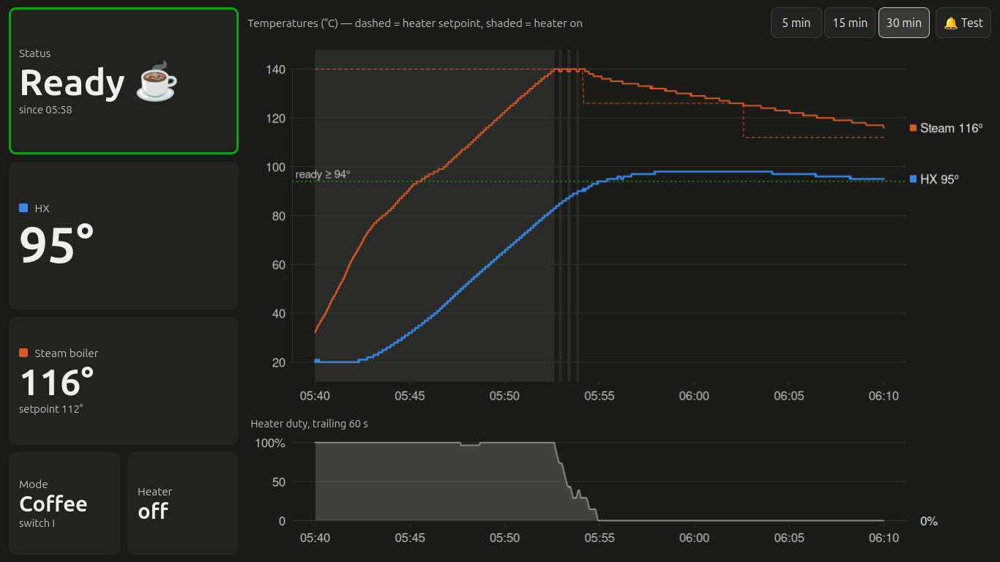

# MaraX Dashboard

A live touchscreen dashboard for the **Lelit MaraX V1** espresso machine, written in R/Shiny.
It reads the machine's serial data stream, charts the boiler and heat-exchanger
temperatures as they change, and plays a sound when the machine is ready to brew.

It runs in any browser and scales to the screen, from a small laptop up to a desktop
monitor. It was built to run full-screen on an old 11-inch laptop sitting next to the
machine, and runs on macOS, Linux and Windows. A built-in simulator lets you work on
it without the machine.

**[Try the live demo →](https://huberthickman.github.io/MaraX_shiny/)**

The demo runs entirely in your browser with [shinylive](https://posit-dev.github.io/r-shinylive/),
with no server and no espresso machine: it replays a real morning's warm-up and a shot,
captured from the machine's serial port, at 10× speed. The first load
takes a little while, because it downloads R itself into the browser. It's published
automatically from `main` by a GitHub Actions workflow.

> **Browser support:** the demo works in current Chrome, Firefox and Edge. It does
> not currently load in Safari. The dashboard itself, running locally or on the
> kitchen laptop, works in any modern browser, Safari included.


*Real data, coffee mode, switch I, shown at 1366×768. Until about 12:35 the machine holds
HX between 93 and 94 °C, pulsing the heater as needed while the steam boiler drifts
between 114 and 120 °C. Then a shot is pulled: the heater setpoint (dashed) jumps to
136 °C, the heater runs flat out for about 2½ minutes (shaded), and HX briefly
spikes before recovering.*

## Features

- **Live tiles:** status, HX temperature (large), steam boiler temperature and
  setpoint, coffee/steam mode, and heater on/off.
- **Temperature chart:** HX and steam boiler on one °C axis, with the controller's
  heater setpoint as a dashed line, the ready threshold as a dotted line, and
  heater-on periods shaded.
- **Heater duty chart:** the share of the last 60 s the heater was on, which shows
  when the machine has settled.
- **5 / 15 / 30-minute views,** with touch-sized buttons.
- **Ready alert:** plays a sound once per warm-up when HX has reached your threshold
  and held steady. A 🔔 **Test** button plays it on demand.
- **No database:** keeps a rolling 30-minute window in memory, with no disk writes.
- **Simulator:** replays a captured serial log from the real machine (or, without
  one, a synthetic warm-up) at adjustable speed, so you can test the layout and the
  alert without the machine.
- **One R process, three platforms:** reads the serial port on macOS, Linux and
  Windows.

## Repository layout

| File | Purpose |
|---|---|
| `marax_shiny_app/app.R` | The whole app: serial reader, rolling buffer, ready detection, charts, UI |
| `marax_shiny_app/marax.yml` | Configuration: serial port, temperature switch setting, thresholds, sound |
| `marax_shiny_app/sample_data.tsv` | A 46-minute capture from the machine (cold start to a shot), replayed by the simulator |
| `.github/workflows/deploy-shinylive.yml` | Builds the in-browser demo with shinylive and publishes it to GitHub Pages |
| `.gitignore` | Keeps local build output (`site/`) and R session files out of the repo |
| `README.md` | This file |
| `LICENSE` | MIT License |
| `images/screenshot.png` | Screenshot used in this README: steady state and a shot |
| `images/warmup.png` | Screenshot used in this README: a cold-start warm-up |

## Requirements

- R 4.x
- R packages: `shiny`, `yaml`, `later`, `beepr`
- **Windows only:** `serial`
- A USB-to-serial adapter connected to the MaraX's serial port (9600 baud, 8N1)

```r
install.packages(c("shiny", "yaml", "later", "beepr"))
install.packages("serial")   # Windows only
```

The same `app.R` runs on every platform. On Windows it loads `serial` to read the
port; on macOS and Linux it reads the port with base R and `stty`, so `serial`
isn't needed there.

## Quick start (simulator)

1. In `marax_shiny_app/marax.yml`, set `simulate: true`.
2. From the repository root, run:
   ```r
   shiny::runApp("marax_shiny_app", port = 3838)
   ```
3. Open <http://localhost:3838>.

With `sim_file: sample_data.tsv`, the simulator replays a real capture: a cold start
at 07:04, the fast-heat phase, the machine settling, and a shot at about 07:47. It
plays `sim_speed` times faster than real time (10× by default, so the 46 minutes take
under 5), and the charts show the original clock times. The ready alert fires at
07:26 replay time, about 2 minutes in. With `sim_loop: true` it starts again from the
cold start when it reaches the end.

Everything time-based speeds up with it, including the chart windows and the
3-minute steadiness rule, so the replay behaves the same at any speed. If `sim_file`
is blank or missing, the simulator generates a synthetic warm-up instead.

### Capturing your own replay file

A capture has one reading per line: an ISO timestamp, a tab, then the raw serial
line, e.g. `2026-10-17T07:04:33.878<TAB>C1.23,020,000,020,0000,0`. On Linux, with
the dashboard stopped (two programs can't share the port), this records one:

```bash
stty -F /dev/ttyUSB0 9600 raw -echo
cat /dev/ttyUSB0 | while IFS= read -r l; do printf '%s\t%s\n' "$(date +%FT%T.%3N)" "$l"; done > capture.tsv
```

Stop it with Ctrl-C, put the file in `marax_shiny_app/`, and point `sim_file` at it.

## Connecting to the machine

### The data stream

The MaraX's Gicar control board sends one comma-separated ASCII line about every half
second. On the V1 board it has six fields:

```
C1.19,116,124,093,0840,1
```

| # | Example | Meaning |
|---|---|---|
| 1 | `C1.19` | Mode letter plus firmware version. `C` = coffee priority, `V` = steam priority |
| 2 | `116` | Steam boiler temperature (°C) |
| 3 | `124` | Steam boiler setpoint (°C). In coffee mode the controller moves this up and down to hold the HX temperature: it drops (e.g. to 112) to keep the heater off and jumps (e.g. to 136) to fire it during a shot |
| 4 | `093` | Heat exchanger (HX) temperature (°C) |
| 5 | `0840` | Fast-heat boost countdown (seconds); `0000` once boost has ended |
| 6 | `1` | Heater on/off |

Some later firmware adds a seventh pump on/off field; the app ignores it.

Every field is zero-padded to a fixed width (temperatures 3 digits, countdown 4,
heater 1). Now and then a character gets lost on the serial line, e.g.
`C1.23,10,140,050,0630,1`, where steam `107` arrived as `10`. The damaged value is
usually still in range and would plot as a spike, so the app drops any line whose
fields aren't the expected width, along with lines that are garbled, have too few
fields, or have out-of-range values. The sample capture has seven such lines in
46 minutes.

The physical temperature switch (0 / I / II) is **not** in the data stream, so you set
it in `marax.yml`.

### Finding the serial port

With `port: auto`, the app uses the first USB serial adapter it finds. To set one
explicitly:

| OS | Port name | How to find it |
|---|---|---|
| Linux | `/dev/ttyUSB0` | `ls /dev/ttyUSB*` before and after plugging in |
| macOS | `/dev/cu.usbserial-XXXX` | `ls /dev/cu.*` before and after plugging in. Use `cu.`, not `tty.` |
| Windows | `COM3` | Device Manager → **Ports (COM & LPT)**, or `serial::listPorts()` |

The Status tile shows which port the app is watching while it waits for data.

To check that data is arriving before you start the app:

```bash
screen /dev/cu.usbserial-XXXX 9600    # macOS; on Linux use /dev/ttyUSB0
# quit with Ctrl-A, then K
```

**Linux:** your user needs to be in the `dialout` group to open the port.
Run `sudo usermod -aG dialout $USER`, then log out and back in.

**Windows:** FTDI, CH340 and CP210x adapters usually install drivers automatically.
A yellow warning icon in Device Manager usually means a PL2303 clone that needs a
different driver.

## Configuration (`marax.yml`)

| Setting | Default | Description |
|---|---|---|
| `port` | `auto` | Serial port path or COM name, or `auto` |
| `window_minutes` | `30` | Minutes of readings kept in memory |
| `temp_setting` | `"II"` | Position of the machine's temperature switch: `"0"`, `"I"` or `"II"` |
| `ready_hx` | 90 / 92 / 94 | HX °C threshold for "ready", one per switch setting |
| `stable_minutes` | `3` | How long HX must hold steady before counting as ready |
| `stable_band` | `1` | Maximum HX variation (°C) allowed during that time |
| `sound` | `3` | beepr sound number or name (`3` / `"fanfare"`, `6` / `"ready"`, `7` / `"shotgun"`, ...), a path to a `.wav`, or `false` for silence |
| `simulate` | `false` | Use the built-in simulator instead of the serial port |
| `sim_file` | `sample_data.tsv` | Capture to replay, relative to the app folder; blank for a synthetic warm-up |
| `sim_speed` | `10` | How many times faster than real time the simulator runs (`1` = real time) |
| `sim_loop` | `true` | Start the replay again from the beginning when it reaches the end |
| `sim_mode` | `C` | Synthetic warm-up only: mode letter `C` or `V` |

To load a config file from somewhere else, set the `MARAX_CONFIG` environment
variable to its path.

### Calibrating the ready threshold

The defaults match the manual's nominal brew temperatures (0 = 90, I = 92,
II = 94 °C). Switch I has been checked against real data: in steady state HX cycles
between 93 and 94 °C, so 92 sits just below it. To check or set yours:

1. Leave the machine on well past warm-up (HX overshoots for a while after a cold
   start or a shot, so wait for it to settle).
2. On the 30-minute view, note the **lowest** HX value in its steady-state cycle.
3. Set `ready_hx` for that switch position about 1 °C below that value.

If the threshold is too high, the dips in the cycle keep the status on
**Warming** and the alert never fires.

## How ready detection works

The machine counts as **ready** when all of these are true:

- the fast-heat boost countdown has reached 0
- at least `stable_minutes` of readings have been collected
- every HX reading in the last `stable_minutes` is at or above `ready_hx`
- HX has varied by no more than `stable_band` °C over that time

The fast-heat countdown alone isn't used, because it ends before the group and HX
have settled.

The sound plays **once per warm-up**:

- Once ready, the status stays **Ready** until the data stream stops (machine off),
  so the temperature drop from pulling a shot doesn't reset it.
- After 30 seconds with no data, the alert re-arms for the next warm-up.
- If the app starts while the machine is already hot, the status shows **Ready** but
  no sound plays.

The R console logs `MaraX ready at HH:MM:SS` when the alert fires. If playback fails,
it logs `Sound failed: ...`.

### What a warm-up looks like



*A cold start in coffee mode, switch I. The machine is switched on at 05:40 with the
steam boiler at about 30 °C and HX at 20 °C.*

- **05:40 – 05:52, fast heat:** the heater runs flat out (shaded, and 100% duty) and
  the steam boiler climbs steadily to about 140 °C. HX lags behind, rising slowly as
  heat moves across from the boiler.
- **05:52 – 05:55, handover:** the heater pulses briefly to hold the boiler near
  140 °C, then switches off. The setpoint (dashed) steps down, first to about 126 °C,
  later to 112 °C.
- **After 05:55, coasting:** with the heater off, the boiler cools slowly while HX
  overshoots to 98 °C and eases back toward its steady range.
- **05:58, ready:** HX passed the threshold at about 05:55 and held steady for the
  next 3 minutes, so the status turned **Ready**, about 18 minutes after switch-on.

## Running it as a kitchen display (Ubuntu or Linux Mint)

These steps set the app up on a dedicated laptop that logs in automatically to the
desktop and opens the dashboard full-screen. They haven't been tested end to end yet.

### 1. Install R, the packages and the app

Use your distribution's R or CRAN's Ubuntu repository. Posit Public Package Manager
serves prebuilt Linux binaries, which install much faster than building from source.
Then clone the repository:

```bash
git clone https://github.com/huberthickman/MaraX_shiny.git ~/MaraX_shiny
```

Give your user access to the serial port (see [Finding the serial port](#finding-the-serial-port)):

```bash
sudo usermod -aG dialout $USER     # then log out and back in
```

### 2. Put this machine's settings outside the repository

Keep the kitchen laptop's config in its own file, so `git pull` never conflicts with
your local settings and the copy in the repository can stay set up for the demo:

```bash
mkdir -p ~/.config/marax
cp ~/MaraX_shiny/marax_shiny_app/marax.yml ~/.config/marax/marax.yml
```

Edit `~/.config/marax/marax.yml`: set `simulate: false`, and set `temp_setting` and
`ready_hx` for your machine. The service in the next step points the app at this
file with the `MARAX_CONFIG` environment variable.

### 3. Start the app at boot as a user service

Run the app as a **user** service, not a system service, so it can reach the desktop's
audio (PipeWire runs per user). Create `~/.config/systemd/user/marax.service`:

```ini
[Unit]
Description=MaraX dashboard

[Service]
WorkingDirectory=%h/MaraX_shiny/marax_shiny_app
Environment=MARAX_CONFIG=%h/.config/marax/marax.yml
ExecStart=/usr/bin/Rscript -e "shiny::runApp('.', host = '127.0.0.1', port = 3838, launch.browser = FALSE)"
Restart=on-failure
RestartSec=5

[Install]
WantedBy=default.target
```

Check that `/usr/bin/Rscript` matches the output of `which Rscript`; if R is installed
somewhere else, use that path. Then enable the service:

```bash
systemctl --user daemon-reload
systemctl --user enable --now marax
sudo loginctl enable-linger $USER     # start at boot, not just at login
journalctl --user -u marax -f         # follow the log
```

Only one program can use the serial port and port 3838 at a time, so don't also run
the app from Positron or RStudio while the service is running.

To view the dashboard from other devices on your network, use `host = '0.0.0.0'`
instead. The app has no login, so only do this on a network you trust.

### 4. Open it full-screen at login

The browser has to wait until the app is up, or it opens on a "can't connect" page.
Create `~/.local/bin/marax-kiosk`:

```bash
#!/bin/bash
# Wait for the dashboard to start, then open it full-screen.
until (exec 3<>/dev/tcp/127.0.0.1/3838) 2>/dev/null; do sleep 2; done
exec firefox --kiosk http://localhost:3838
```

Make it executable with `chmod +x ~/.local/bin/marax-kiosk`, then create
`~/.config/autostart/marax-kiosk.desktop`, replacing `hubert` with your username
(autostart files need the full path):

```ini
[Desktop Entry]
Type=Application
Name=MaraX kiosk
Exec=/home/hubert/.local/bin/marax-kiosk
```

Firefox comes with both Ubuntu and Linux Mint. To use Chromium instead, change the
last line of the script to `exec chromium --kiosk http://localhost:3838`. To leave
kiosk mode, press Alt+F4.

Finally, in the desktop's settings, turn on **automatic login** for your user and set
**screen blanking** to suit the kitchen. On Linux Mint these are under Login Window
and Screensaver / Power Management; on Ubuntu, under Users and Power.

### 5. Test the sound

Press 🔔 **Test** on the dashboard. If it's silent, run `beepr::beep(3)` in R as the
same user. If that's silent too, the problem is the audio setup rather than the app.
The service starts at boot, but sound only works once the desktop session has logged
in, which automatic login takes care of.

### Updating

```bash
cd ~/MaraX_shiny && git pull
systemctl --user restart marax
```

## Running on Windows 11

- Install the `serial` package in addition to the others.
- Set `port` to your COM port, or leave it on `auto`. `auto` picks the
  highest-numbered COM port, which is usually the USB adapter.
- Start the app at logon with a Task Scheduler task that runs:
  ```
  "C:\Program Files\R\R-4.x.x\bin\Rscript.exe" -e "shiny::runApp('.', port = 3838)"
  ```
  Set **Start in** to the `marax_shiny_app` folder of your copy of the repository.
- Open it full-screen with Edge:
  `msedge --kiosk http://localhost:3838 --edge-kiosk-type=fullscreen`

The Windows serial code path has not yet been tested against the machine.

## Display

The tiles sit in a left column and the charts fill the rest of the screen. Everything
is sized from the browser window, so the page fits without scrolling at any common
laptop or desktop resolution:

- **Larger screens:** the charts grow to fill the space, and the tiles and text grow
  up to a comfortable maximum.
- **Smallest supported size:** about **1366×768**, the resolution of a typical
  11-inch laptop. The layout is tested there both full-screen and in a browser
  window with its toolbar showing. Much smaller windows can clip text in the tiles.

To preview the smallest size on another computer, open Chrome DevTools, turn on the
device toolbar, and set it to 1366 × 768 at DPR 1.

Charts are drawn on the server with base R graphics and refresh every 2 seconds; the
tiles refresh every second. This keeps the load light on a low-power laptop. The
trade-off is that charts have no hover tooltips.

## Troubleshooting

| Symptom | Things to check |
|---|---|
| Status shows **No data** with a port name | Is the machine on? Does `screen` show data? On Linux, is your user in `dialout`? |
| Status shows **auto (none found)** | The adapter isn't detected. Check `ls /dev/cu.*`, `ls /dev/ttyUSB*`, or Device Manager |
| Status stays on **Warming** | HX hasn't reached `ready_hx` for your `temp_setting`, or hasn't held steady. Recalibrate the threshold |
| Status says **Ready** but there was no sound | The app started with the machine already hot (by design), or sound failed. Check the log and press 🔔 Test |
| No sound from the user service | Run `beepr::beep(3)` as that user; make sure the desktop session is logged in |

## Limitations and next steps

- **No history:** readings live only in memory, so a restart or a new day starts with
  an empty chart.
- **No shot detection yet:** the V1 board doesn't report the pump. Shots could be
  inferred from sharp HX drops, or detected exactly with a reed switch on the pump.
- **Storage is isolated behind two functions:** `add_reading()` and
  `recent_readings()` are the only code that touches the buffer. Adding persistent
  storage, such as DuckDB, means changing only those two functions.

## Acknowledgements

Developed with assistance from [Claude](https://claude.ai).

## License

Released under the [MIT License](LICENSE). Copyright (c) 2026 Hubert Hickman.

Lelit and MaraX are trademarks of their respective owners. This is an independent
hobby project, not affiliated with or endorsed by Lelit.